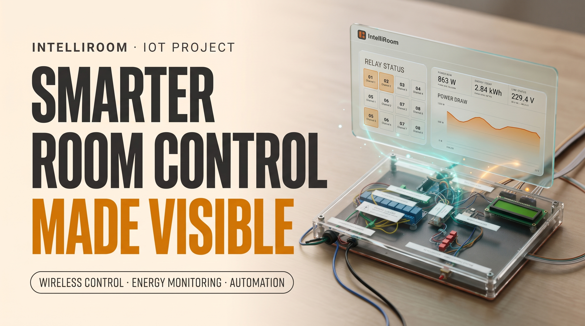
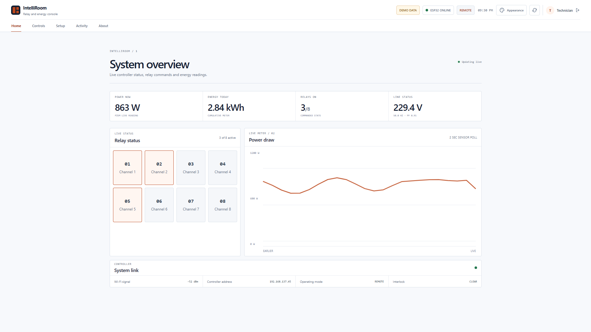
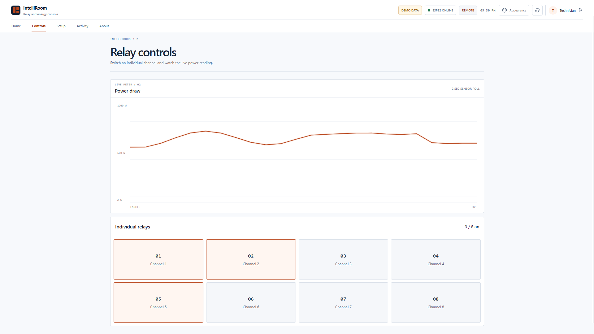
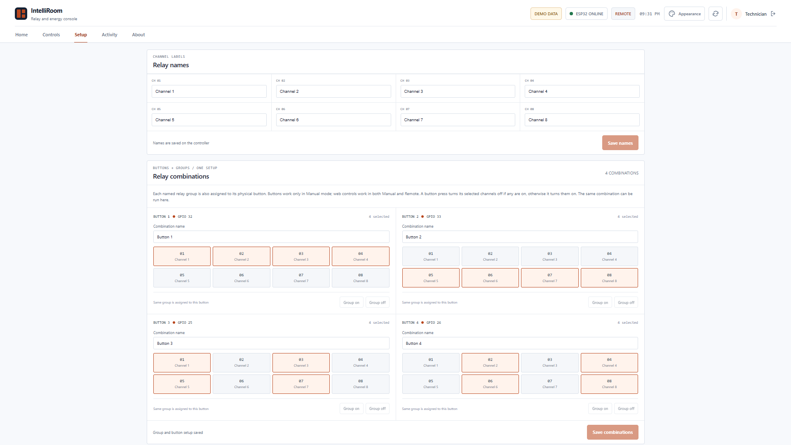
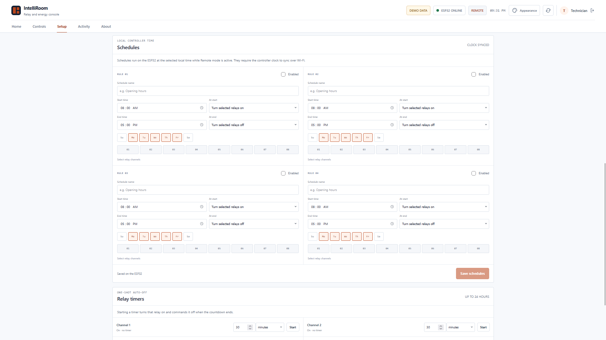
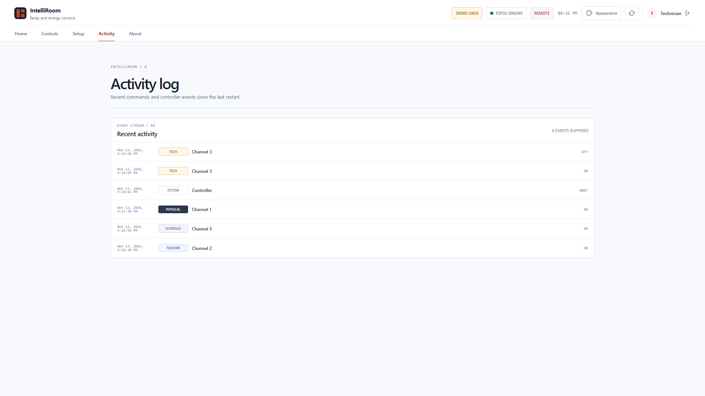
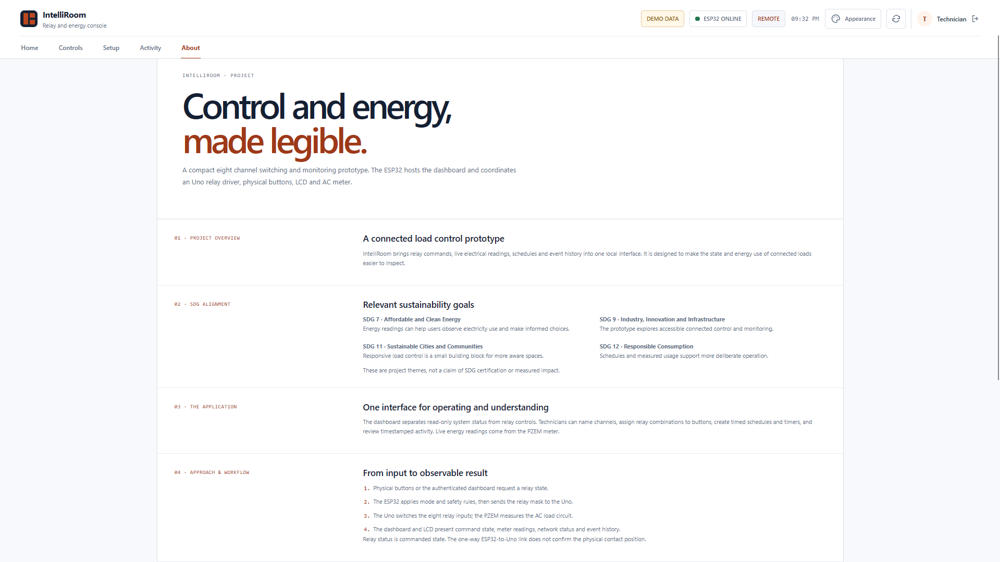
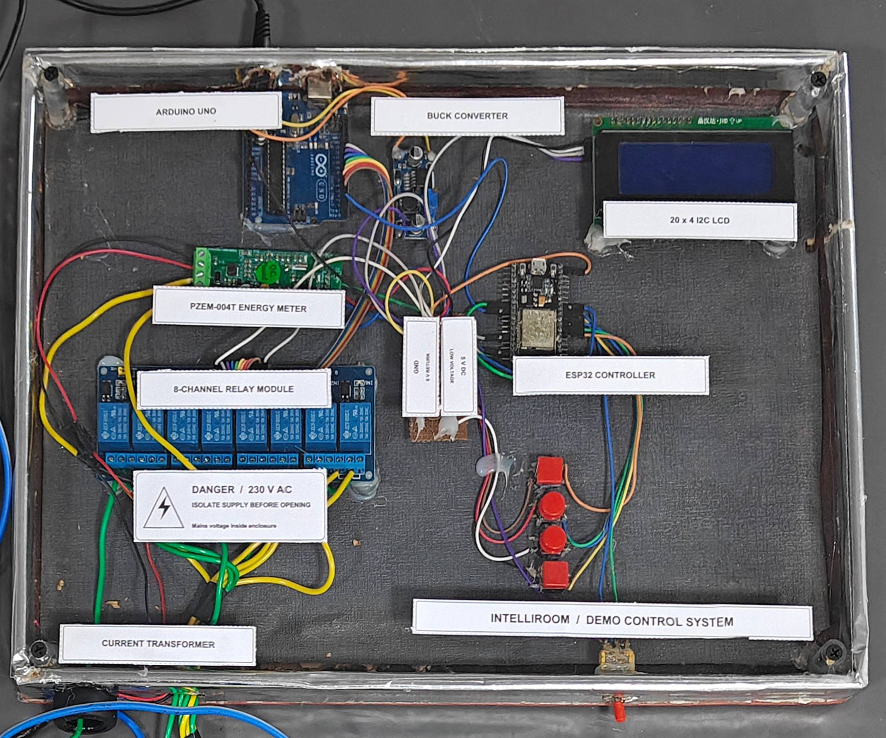
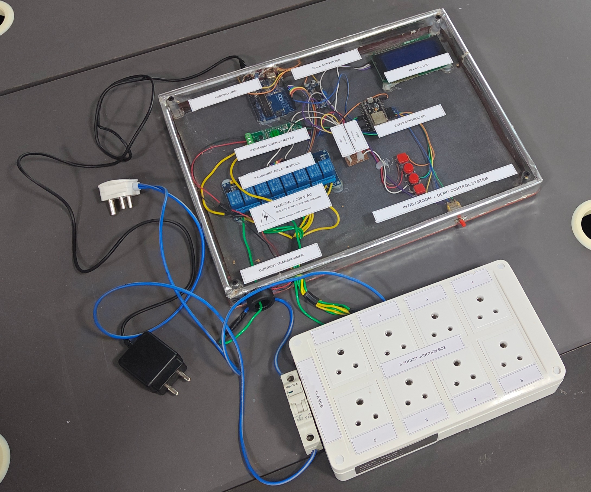
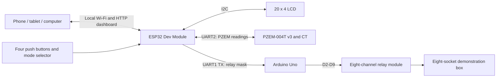

<p align="center">
  
</p>

<h1 align="center">IntelliRoom</h1>
<p align="center"><strong>IoT Wireless Actuation Hub for Smart Energy Monitoring and Control</strong></p>
<p align="center">A student-built demonstration prototype combining relay control, a responsive local dashboard, physical inputs, an LCD, and an energy-meter interface.</p>

> **Prototype status:** This repository documents a demonstration build, not a certified household installation. The ESP32-to-Uno relay link is one-way, so the interface shows the last commanded relay state rather than independently confirmed contact state. PZEM readings and loaded mains operation still require controlled verification. The thumbnail is illustrative artwork; any values or labels drawn inside it are not measured project data.

## Project overview

IntelliRoom explores a practical way to bring switching, monitoring, and simple automation into one interface. An ESP32 hosts the web console and coordinates system behavior. An Arduino Uno receives compact relay-mask commands and drives a single eight-channel relay bank. Users can operate the system from the local web interface or from mapped push buttons, view status on a 20×4 LCD, and read electrical measurements when the PZEM-004T meter is connected and returning valid data.

The project emphasizes a modular two-controller architecture: network and application logic stay on the ESP32, while the Uno has the narrow job of applying relay output commands. The demo uses an eight-socket junction box and includes a 16 A MCB. It has **not** been integrated into a household switch box.

### Project goals

- Provide individual control of the eight relay channels through a responsive dashboard.
- Support local push-button combinations and a physical Manual/Remote mode selector.
- Let a technician rename channels, create relay combinations, and save button mappings.
- Provide schedules, per-channel timers, recent activity, and a live energy graph when its meter data is available.
- Present meaningful operating, network, relay-command, and meter information on the LCD.
- Keep the prototype's limitations visible instead of presenting commanded states or demo values as verified measurements.

## Demonstration media

The dashboard screenshots below show the interface with **mock/demo data**. The readings in those screenshots are illustrative and are not measurements from the prototype.

### Dashboard home



### Relay controls and power chart



### Button and relay-combination setup



### Schedule and timer setup



### Activity log



### About and connection reference



### Physical MVP





## System architecture



### Command path

1. A browser action, scheduled rule, timer, or allowed physical button changes a channel's **desired/commanded state** in ESP32 memory.
2. The ESP32 applies the active mode, interlock, and command-source rules, then forms a bit mask for all channels.
3. The ESP32 sends a line-based `M,FFFF` hexadecimal mask at 9600 baud to the Uno.
4. The Uno maps mask bits to relay channels and drives its output pins. Relay polarity is configured as active-low in the supplied Uno protocol header.
5. The dashboard and LCD display the ESP32's commanded state. There is no acknowledgement or electrical feedback from the Uno in this version.

The PZEM meter uses a separate ESP32 UART. Firmware requests voltage, current, power, cumulative energy, frequency, and power factor at a two-second polling interval. A missing or invalid meter response is surfaced as unavailable data; a drawn graph should not be interpreted as a real measurement unless the meter is connected and verified.

## Operating modes and behavior

### Remote mode

- Selected when the GPIO27 mode input is **HIGH**.
- Authenticated dashboard controls remain available.
- Time-based schedules and automation may run when the ESP32 clock is synchronized.
- The four physical relay buttons are ignored.

### Manual mode

- Selected when the GPIO27 mode input is **LOW**.
- The four physical buttons toggle their saved relay combinations.
- Dashboard controls continue to work in Manual mode.
- Schedules are paused while Manual mode is selected.

### Relay combinations, schedules, and timers

- Each of four physical buttons can be given a technician-defined name and a selection of channels. The same configuration is used as a saved relay combination in the UI.
- A button press turns its selected channels on when all are off; if any selected channel is already on, it turns that selection off.
- The firmware has four weekly schedule slots. Each slot supports a name, weekdays, a start and end time, selected channels, and separate start/end ON or OFF actions.
- Individual relay timers support durations from zero to 24 hours. Starting a timer switches the channel on and turns it off at expiry.
- Schedule and timer operation requires valid network time from NTP. The configured default timezone offset is UTC+05:30.
- Technician settings (channel names, groups/button mappings, and schedules) are saved in ESP32 Preferences/non-volatile storage.

## Dashboard pages

| Page | Purpose |
| --- | --- |
| **Home** | Read-only overview of relay commanded states, meter values, power history, Wi-Fi link, controller address, operating mode, and interlock status. |
| **Controls** | Individual relay switching and the prominent live power-draw graph. |
| **Setup** | Channel names, combined relay-group/button mapping, schedule rules, and channel timers. |
| **Activity** | Recent timestamped actions from the controller and users. The current firmware keeps a rolling 24-entry log in RAM; it is cleared on reboot. |
| **About** | Project overview, thematic SDG alignment, hardware, and connection reference. |

The console is a React and TypeScript application. On `localhost`, it automatically selects clearly marked mock data so the dashboard can be previewed without hardware. The ESP32 build serves the embedded dashboard and uses the authenticated device API.

## Hardware components

| Component | Role in IntelliRoom |
| --- | --- |
| ESP32 Dev Module | Wi-Fi, local HTTP server, dashboard API, mode and button inputs, LCD, meter interface, schedules, timers, and system policy. |
| Arduino Uno | Receives serial relay-mask commands and drives the relay input pins. It does not make network or scheduling decisions. |
| Eight-channel relay module | Provides the eight switched output channels. The supplied sketch assumes active-low input logic; verify the actual board before connecting loads. |
| PZEM-004T v3 with CT coil | Intended to measure AC voltage/current/power/energy/frequency/power factor. Meter and CT integration must be confirmed on the actual module. |
| 20×4 I²C LCD | Rotates through live summary, relay mask, meter, energy, Wi-Fi/IP/clock, and boot-time button diagnostics. |
| Four momentary push buttons | Local controls mapped to saved combinations; read with ESP32 internal pull-ups. |
| SPDT mode selector | Selects Manual or Remote operation on ESP32 GPIO27. |
| Regulated 5 V supply / buck converter | Supplies the low-voltage rail for compatible logic and relay hardware, sized for the actual load. |
| Eight-socket junction box and 16 A MCB | Demo load enclosure and protective device included in the prototype. Their selection, enclosure, and wiring have not been certified here. |

## Connection reference

These are the **low-voltage signal assignments in the firmware**. They are not a mains wiring diagram.

| From | To | Notes |
| --- | --- | --- |
| ESP32 GPIO17 TX | Uno D0 / RX | One-way 9600-baud command link. Share signal ground. Disconnect this wire while uploading to the Uno because it uses the Uno hardware RX pin. |
| Uno D2-D9 | Relay IN1-IN8 | Channel one maps to D2 and channel eight maps to D9. Relay input polarity is configured active-low. |
| ESP32 GPIO21 | LCD SDA | I²C data. |
| ESP32 GPIO22 | LCD SCL | I²C clock. Firmware initializes the LCD at address `0x27`; adjust if the module uses another address. |
| ESP32 GPIO16 RX | PZEM TX | UART2 receive direction. |
| ESP32 GPIO14 TX | PZEM RX | UART2 transmit direction. The PZEM UART is configured for 9600 baud. Use appropriate level translation if the actual meter TX level exceeds ESP32 GPIO tolerance. |
| ESP32 GPIO32, GPIO33, GPIO25, GPIO26 | Four momentary buttons | Each button connects its GPIO input to GND when pressed. The firmware enables `INPUT_PULLUP`. |
| ESP32 GPIO27 | Center contact of SPDT selector | One outer contact to 3.3 V (Remote/HIGH), the other to GND (Manual/LOW). Never apply 5 V to an ESP32 GPIO. |
| LCD, ESP32, Uno, PZEM logic, relay logic grounds | Common low-voltage ground | External supply negative is the low-voltage reference. Keep this rail isolated from AC conductors. |

The external regulated 5 V supply powers the 5 V rail. Avoid connecting USB power and an external feed to the ESP32 5 V/VIN rail at the same time unless the board's power-path design explicitly supports it. Do not use the ESP32 3.3 V output to power relay coils.

**AC measurement and switched-load wiring:** the PZEM's AC input, CT, relay contacts, sockets, and MCB involve hazardous mains voltage. Do not infer terminal order from an unmarked module or this software pin table. Have a qualified person identify the exact module terminals, verify clearances and protection, and inspect the enclosed build before energizing it.

## Firmware and dashboard source layout

```text
firmware/
  arduino-uno/IntelliRoomRelayController/
    IntelliRoomRelayController.ino   # serial parser and relay outputs
    protocol.h                       # channel pins and active-low polarity
  esp32/IntelliRoomESP32/
    IntelliRoomESP32.ino             # controller, web API, modes, schedules
    config.example.h                # safe template; copy to config.h locally
    api.h, devices.h, energy.h
    lcd_ui.h, priority.h, protocol.h
    dashboard_ui.h                   # generated compressed dashboard bundle
  esp32/ButtonPinDiagnostic/         # standalone button input diagnostic
dashboard/
  src/                               # React UI, API client, types and styles
  scripts/embed-ui.mjs               # embeds built UI into firmware header
docs/
  assets/                            # thumbnail, prototype photos, UI captures
  carousel-slides/                   # individual high-resolution carousel slides
  IntelliRoom-LinkedIn-Carousel.pdf  # six-page, print-ready 4:5 project carousel
  IntelliRoom-A3-Project-Poster.pdf
  IntelliRoom-Sticker-Sheet-A4.pdf
  poster_assets/                     # packaged assets used by the poster source
  create_intelliroom_linkedin_carousel.py
  create_intelliroom_a3_poster.py
  create_intelliroom_stickers.py
```

## Build and upload

### Build the dashboard bundle

Node.js/npm are required. From the repository root:

```powershell
cd dashboard
npm ci
npm run build:firmware
cd ..
```

This builds the dashboard and regenerates `firmware/esp32/IntelliRoomESP32/dashboard_ui.h`. Commit that header with dashboard changes so the ESP32 serves the same UI as the source tree.

### Configure the ESP32

Create your local configuration from the checked-in template, then edit it before compiling:

```powershell
Copy-Item firmware/esp32/IntelliRoomESP32/config.example.h firmware/esp32/IntelliRoomESP32/config.h
```

- Replace `YOUR_WIFI_SSID` and `YOUR_WIFI_PASSWORD` with local network credentials.
- Replace the example teacher and technician usernames/passwords with unique values.
- Keep your real credentials out of commits, screenshots, issues, and public releases. The checked-in file contains placeholders only.
- The actual `config.h` is ignored by Git so your local network and login values stay out of commits.

### Compile

Install the ESP32 board core and the libraries used by the sketch: **ESPAsyncWebServer**, **AsyncTCP**, **ArduinoJson**, **LiquidCrystal_I2C**, and **PZEM004Tv30**. The Uno relay sketch requires only the Arduino AVR core.

```powershell
arduino-cli compile --fqbn arduino:avr:uno firmware/arduino-uno/IntelliRoomRelayController
arduino-cli compile --fqbn esp32:esp32:esp32 firmware/esp32/IntelliRoomESP32
```

The target board used for the ESP32 firmware is **ESP32 Dev Module** (`esp32:esp32:esp32`). Select the correct serial port for upload. Disconnect GPIO17 from Uno D0/RX during Uno flashing, then restore the link after upload.

### Open the embedded dashboard

1. Upload the Uno relay sketch and the configured ESP32 sketch.
2. Open the ESP32 Serial Monitor at 115200 baud and note its printed local IP address.
3. Visit `http://<esp32-ip>/` from a device on the same Wi-Fi network and sign in with the credentials configured in `config.h`.
4. Use the technician account for names, relay combinations, mode, schedules, and timers.

Local operation uses plain HTTP on the LAN. For access from away from the local network, use a private VPN such as Tailscale; do not expose the ESP32 HTTP port directly to the public Internet.

### Preview mock data without hardware

```powershell
cd dashboard
npm ci
npm run dev
```

Open the local address printed by Vite. `localhost` and `127.0.0.1` use the UI's built-in mock/demo data. Controls on this preview do not operate physical relays.

## Validation status and known limitations

- The source implements the ESP32-to-Uno relay-mask protocol and maps eight channels to Uno D2-D9; the serial link is one-way and has no physical-state return path.
- The demo dashboard screenshots use synthetic readings and activity events. They are for interface demonstration only.
- The PZEM-004T and CT measurement path has not been calibrated or validated for this release. Until it is, the dashboard must show meter data as unavailable rather than imply a real reading.
- Button inputs use `INPUT_PULLUP`; GPIO32, GPIO33, GPIO25, and GPIO26 are the assigned button pins. GPIO34/35 do not support internal pull-ups.
- NTP/Wi-Fi availability is required for clock-based schedules and timer deadlines.
- The activity ring contains up to 24 in-memory entries and is not retained through a reboot.
- No energy-savings percentage, electrical certification, or household installation approval is claimed.

## Safety

This is an educational prototype, not a certified mains product. AC wiring can cause fatal shock, fire, and equipment damage. Keep low-voltage logic separated from mains conductors, use a suitable closed enclosure and correctly rated components, and have all AC wiring and protection reviewed by a qualified electrician before energizing any load. Test control logic with loads disconnected first. The presence of an MCB alone does not establish that the assembly is safe.


## Sustainability context

IntelliRoom explores themes related to SDG 7 (Affordable and Clean Energy), SDG 9 (Industry, Innovation and Infrastructure), SDG 11 (Sustainable Cities and Communities), and SDG 12 (Responsible Consumption and Production). This is a project-theme alignment, not a claim of SDG certification or measured environmental impact.

## Project documents

- [Detailed A3 project poster](docs/IntelliRoom-A3-Project-Poster.pdf)
- [IntelliRoom LinkedIn carousel PDF](docs/IntelliRoom-LinkedIn-Carousel.pdf)
- [Individual high-resolution carousel slides](docs/carousel-slides/)
- [Carousel contact sheet preview](docs/IntelliRoom-LinkedIn-Carousel-ContactSheet.jpg)
- [Component sticker sheet](docs/IntelliRoom-Sticker-Sheet-A4.pdf)
- [Source images and dashboard screenshots](docs/assets/)

## License

No open-source license has been added yet. Unless a license is added, the source is available for review but reuse and redistribution are not automatically granted.
